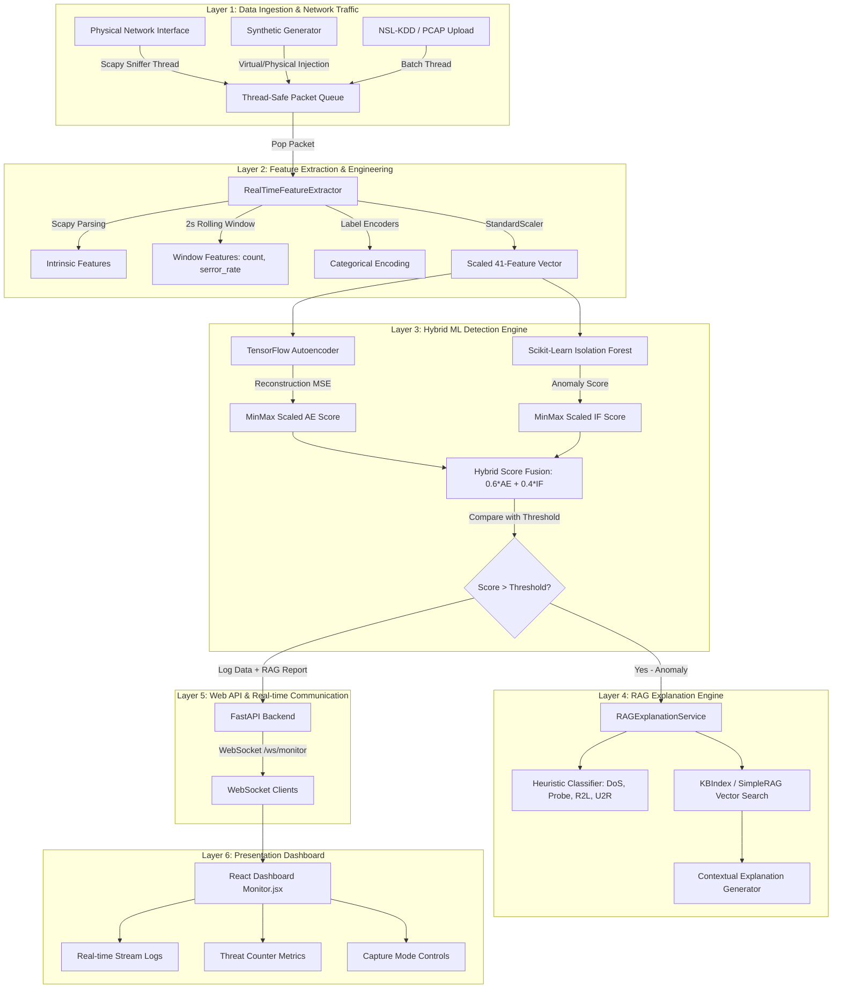
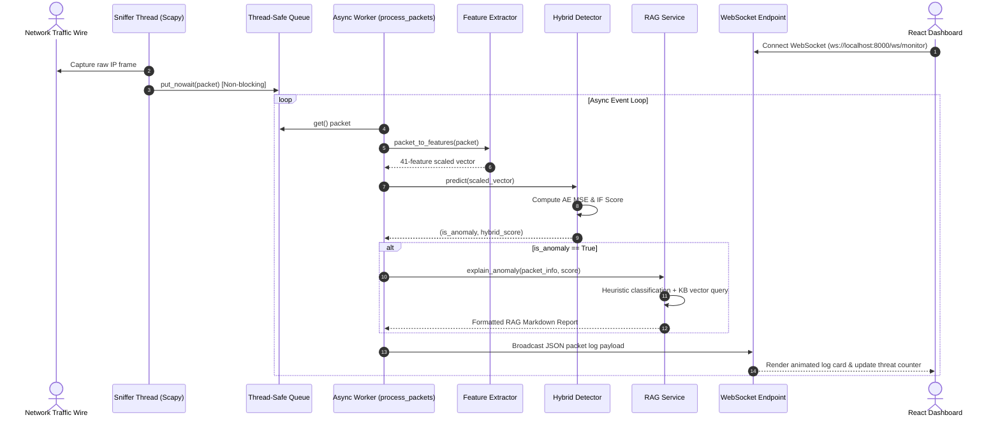

# Comprehensive Technical Analysis: Hybrid ML-Based Network Intrusion Detection System (NIDS)

---

## 1. Executive Summary & System Overview

### 1.1 Project Purpose & Domain
The **Hybrid ML-based Network Intrusion Detection System (NIDS)** (Project Codename: **Hybrid 2**) is an enterprise-grade, real-time cybersecurity platform designed to monitor network traffic, identify malicious intrusion patterns, and produce explainable security intelligence. 

Traditional intrusion detection systems rely primarily on fixed signature database lookups (e.g., Snort rules), which fail against zero-day exploits, emerging malware variations, or subtle anomalous traffic behavior. Hybrid NIDS bridges this critical gap by combining:
1. **Unsupervised Deep Learning (Autoencoder)** to measure non-linear reconstruction errors of complex packet structures.
2. **Statistical Anomaly Detection (Isolation Forest)** to identify isolated structural outliers across multi-dimensional feature spaces.
3. **Retrieval-Augmented Generation (RAG)** to correlate flagged anomalies with security knowledge bases (NSL-KDD taxonomy & MITRE ATT&CK patterns) and generate contextual security analysis reports.
4. **Asynchronous Packet Sniffing & Streaming Architecture** using Scapy, multi-threaded queues, WebSockets, and a React-based monitoring dashboard.

---

## 2. High-Level Architecture & Layered Breakdown

The application follows an event-driven, micro-layered decoupled architecture.



### Universal Architecture Flow Diagram (ASCII Representation)

```text
+-------------------------------------------------------------------------------------------------------+
|                                    LAYER 1: DATA INGESTION LAYER                                      |
|                                                                                                       |
|   +----------------------------+     +----------------------------+     +-------------------------+   |
|   | Physical Network Interface |     | Synthetic Generator        |     | NSL-KDD / PCAP File     |   |
|   | (Live Scapy Thread)        |     | (Virtual/Physical Injection|     | (Batch Stream Thread)   |   |
|   +--------------+-------------+     +--------------+-------------+     +------------+------------+   |
|                  |                                  |                                |                |
|                  +----------------------------------+--------------------------------+                |
|                                                     |                                                 |
|                                                     v                                                 |
|                                     +-------------------------------+                                 |
|                                     |  Thread-Safe Packet Queue     |                                 |
|                                     |  (queue.Queue - Non-blocking) |                                 |
|                                     +---------------+---------------+                                 |
+-----------------------------------------------------|-------------------------------------------------+
                                                      |
                                                      v
+-------------------------------------------------------------------------------------------------------+
|                                LAYER 2: FEATURE EXTRACTION & ENGINEERING                              |
|                                                                                                       |
|                                     +-------------------------------+                                 |
|                                     | RealTimeFeatureExtractor      |                                 |
|                                     +---------------+---------------+                                 |
|                                                     |                                                 |
|          +----------------------+-------------------+----------------------+--------------------+     |
|          |                      |                   |                      |                    |     |
|          v                      v                   v                      v                    v     |
|   +--------------+      +---------------+   +---------------+      +---------------+    +-----------+ |
|   | Intrinsic    |      | 2s Rolling    |   | Label Encoders|      | StandardScaler|    | 41-Dim    | |
|   | Features     |      | Window Stats  |   | (joblib)      |      | (joblib)      |    | Vector    | |
|   +--------------+      +---------------+   +---------------+      +---------------+    +-----+-----+ |
+-----------------------------------------------------------------------------------------------|-------+
                                                                                                |
                                                                                                v
+-------------------------------------------------------------------------------------------------------+
|                               LAYER 3: HYBRID ML DETECTION ENGINE                                     |
|                                                                                                       |
|                                     +-------------------------------+                                 |
|                                     | Scaled 41-Feature Vector      |                                 |
|                                     +---------------+---------------+                                 |
|                                                     |                                                 |
|                           +-------------------------+-------------------------+                       |
|                           |                                                   |                       |
|                           v                                                   v                       |
|           +-------------------------------+                   +-------------------------------+       |
|           | TensorFlow Autoencoder        |                   | Scikit-Learn Isolation Forest |       |
|           | (Reconstruction Error MSE)    |                   | (Statistical Anomaly Score)   |       |
|           +---------------+---------------+                   +---------------+---------------+       |
|                           |                                                   |                       |
|                           v (MinMax Scaled AE Score)                          v (MinMax Scaled IF)    |
|                           +-------------------------+-------------------------+                       |
|                                                     |                                                 |
|                                                     v                                                 |
|                                     +-------------------------------+                                 |
|                                     |  Hybrid Score Fusion          |                                 |
|                                     |  Score = 0.6*AE + 0.4*IF      |                                 |
|                                     +---------------+---------------+                                 |
|                                                     |                                                 |
|                                                     v                                                 |
|                                           /-------------------\                                       |
|                                          /  Is Hybrid Score    \                                      |
|                                         <   > Anomaly Threshold? >                                    |
|                                          \  (e.g., threshold.txt)/                                    |
|                                           \-------------------/                                       |
+-----------------------------------------------------|-------------------------------------------------+
                                                      |
                                                      | YES (Anomaly Flagged)
                                                      v
+-------------------------------------------------------------------------------------------------------+
|                               LAYER 4: RAG EXPLANATION ENGINE                                         |
|                                                                                                       |
|                                     +-------------------------------+                                 |
|                                     | RAGExplanationService         |                                 |
|                                     +---------------+---------------+                                 |
|                                                     |                                                 |
|                           +-------------------------+-------------------------+                       |
|                           |                                                   |                       |
|                           v                                                   v                       |
|           +-------------------------------+                   +-------------------------------+       |
|           | Heuristic Attack Classifier   |                   | Vector Knowledge Base Index   |       |
|           | (DoS, Probe, R2L, U2R)        |                   | (KBIndex / SimpleRAG Cosine)  |       |
|           +---------------+---------------+                   +---------------+---------------+       |
|                           |                                                   |                       |
|                           +-------------------------+-------------------------+                       |
|                                                     |                                                 |
|                                                     v                                                 |
|                                     +-------------------------------+                                 |
|                                     | LLM / Template Synthesis      |                                 |
|                                     | (Detailed Threat Analysis)    |                                 |
|                                     +---------------+---------------+                                 |
+-----------------------------------------------------|-------------------------------------------------+
                                                      |
                                                      v (Log Data + RAG Report)
+-------------------------------------------------------------------------------------------------------+
|                               LAYER 5: WEB API & REAL-TIME STREAMING                                  |
|                                                                                                       |
|                                     +-------------------------------+                                 |
|                                     | FastAPI Backend API Router    |                                 |
|                                     +---------------+---------------+                                 |
|                                                     |                                                 |
|                                                     v                                                 |
|                                     +-------------------------------+                                 |
|                                     | WebSocket Server (/ws/monitor)|                                 |
|                                     +---------------+---------------+                                 |
+-----------------------------------------------------|-------------------------------------------------+
                                                      |
                                                      v (Real-time Broadcast)
+-------------------------------------------------------------------------------------------------------+
|                               LAYER 6: PRESENTATION DASHBOARD                                         |
|                                                                                                       |
|                                     +-------------------------------+                                 |
|                                     | React Monitoring Dashboard    |                                 |
|                                     | (Monitor.jsx / App.jsx)       |                                 |
|                                     +---------------+---------------+                                 |
|                                                     |                                                 |
|          +------------------------------------------+-----------------------------------------+       |
|          |                                          |                                         |       |
|          v                                          v                                         v       |
|   +-----------------------+              +-----------------------+             +----------------------+
|   | Real-time Stream Logs |              | Threat Metric Counters|             | Capture Controls     |
|   | & Animated Cards      |              | (Total vs Anomalies)  |             | & Upload Modals      |
|   +-----------------------+              +-----------------------+             +----------------------+
+-------------------------------------------------------------------------------------------------------+
```

---

## 3. Layer-by-Layer Architectural Unfolding

### Layer 1: Data Ingestion Layer
* **Components**: `scapy.sniff()`, `SyntheticTrafficGenerator`, PCAP/CSV file streaming thread.
* **Mechanism**: High-frequency packet sniffing runs on a dedicated background OS thread. To prevent dropping incoming frames during peak traffic spikes, the sniffer places raw `Scapy` IP packet frames into a thread-safe `queue.Queue()` without performing heavy compute.
* **Key Innovation**: Supports 4 distinct capture modes:
  1. *Live Network Interface* (captures active NIC frames).
  2. *Virtual Synthetic Injection* (simulates in-memory attacks like SYN Flood, LAND attacks, and Port Scans directly into the processing queue).
  3. *Physical Synthetic Injection* (crafts and transmits raw socket frames onto the physical network wire).
  4. *Dataset Stream Processing* (ingests offline NSL-KDD benchmark `.csv`/`.txt` files or `.pcap` dumps line-by-line).

### Layer 2: Feature Extraction & Data Engineering Layer
* **Components**: `RealTimeFeatureExtractor` (`sniffer.py`), `calibrate_scalers.py`.
* **Mechanism**: Transforms raw network packets into a normalized 41-feature vector identical to the NSL-KDD benchmark representation:
  - **Intrinsic Features**: Protocol type, target service, TCP flag status, payload sizes (`src_bytes`, `dst_bytes`), fragment errors, urgent pointers, and LAND flags.
  - **Time-Series / Window-Based Features**: Maintains a 2-second sliding window (`packet_history`) tracking historical packet timestamps, source/destination IPs, target services, and TCP error states. Calculates time-series statistics like `count`, `srv_count`, `serror_rate`, and `srv_serror_rate`.
  - **Categorical Transformation**: Encoders (`le_proto.joblib`, `le_service.joblib`, `le_flag.joblib`) map string labels (`tcp`, `http`, `SF`, `S0`, etc.) to numerical values.
  - **Normalization**: Standardizes numerical values using `standard_scaler.joblib`.

### Layer 3: Hybrid Machine Learning Detection Engine
* **Components**: `HybridDetector` (`detector.py`), `autoencoder.keras`, `iso_forest.joblib`, `ae_scaler.joblib`, `if_scaler.joblib`, `threshold.txt`.
* **Mechanism**: Combines two complementary unsupervised learning paradigms:
  1. **Deep Autoencoder (Keras Neural Network)**: Evaluates input feature vectors by reconstructing them. High Mean Squared Error (MSE) between input $X$ and reconstructed output $\hat{X}$ signals novel attack patterns:
     $$\text{MSE} = \frac{1}{N} \sum_{i=1}^N (X_i - \hat{X}_i)^2$$
  2. **Isolation Forest (Scikit-Learn Ensemble)**: Isolate anomalies by randomly partitioning feature values using decision trees. Anomalous instances require fewer splits, yielding higher anomaly decision scores:
     $$\text{IF\_Score} = - \text{decision\_function}(X)$$
  3. **Score Fusion & Scaling**: Both raw scores are normalized to $[0, 1]$ using pre-calibrated `MinMaxScaler` instances (`ae_scaler.joblib` and `if_scaler.joblib`). The hybrid anomaly score is computed as:
     $$S_{\text{hybrid}} = \alpha \cdot \text{AE}_{\text{norm}} + (1 - \alpha) \cdot \text{IF}_{\text{norm}} \quad (\text{where } \alpha = 0.6)$$
  4. **Threshold Evaluation**: If $S_{\text{hybrid}} > \text{threshold}$ (retrieved from `threshold.txt`), the packet is flagged as an intrusion anomaly.

### Layer 4: RAG Explanation Engine
* **Components**: `RAGExplanationService` (`rag_service.py`), `KBIndex` (`kb_index.py`), `SimpleRAG` (`rag_knowledge.py`), `knowledge_base.json`, `knowledge_base_enhanced.json`.
* **Mechanism**:
  1. **Heuristic Pre-classification**: Maps observed packet metadata and metric spikes to known attack categories:
     - `DoS`: `serror_rate > 0.5` or `src_bytes > 50,000`.
     - `R2L` (Remote to Local): Services like `telnet`, `ftp`, `imap4`.
     - `U2R` (User to Root): Services like `shell`, `login`.
     - `Probe`: `diff_srv_rate > 0.5`.
  2. **Vector Similarity Retrieval**: `KBIndex` computes vector embeddings of knowledge base entries using OpenAI (`text-embedding-3-small`) or SentenceTransformers (`all-MiniLM-L6-v2`), performing cosine nearest-neighbor queries to pull top matching attack signatures.
  3. **Fallback Keyword Retriever**: If embedding models are unavailable, `SimpleRAG` performs lightweight, dependency-free token occurrence matching.
  4. **Synthesis**: Produces a detailed markdown explanation specifying classification category, root causes, observed indicator flags, technical packet metadata, and recommended mitigation knowledge snippets.

### Layer 5: Web API & Middleware Layer
* **Components**: FastAPI (`main.py`), Auth module (`auth.py`), Database ORM (`database.py`, `models.py`, `schemas.py`).
* **Mechanism**:
  - **REST API Endpoints**: Handle user authentication (`/signup`, `/token`, `/login/google`, `/auth/google`, `/users/me`), capture mode execution (`/api/capture/mode`), and offline dataset file uploads (`/api/upload_dataset`).
  - **Session & CORS Middleware**: Ensures secure cross-origin requests from the React frontend and handles stateful OAuth sessions.
  - **WebSocket Server (`/ws/monitor`)**: Maintains real-time full-duplex socket connections with dashboard clients to stream packet logs and threat alerts asynchronously.
  - **Database & Auth**: Persists user credentials in SQLite (`sql_app.db`) with `bcrypt` password hashing and signed JWT tokens (HS256).

### Layer 6: Frontend Dashboard Layer
* **Components**: React 19, Vite, Tailwind CSS, Axios, Lucide React (`Monitor.jsx`, `Login.jsx`, `Signup.jsx`, `App.jsx`).
* **Mechanism**:
  - Provides a modern dark-mode monitoring interface with real-time log rendering (capped at 100 entries to maintain high performance).
  - Displays dynamic traffic meters (total packets vs total anomalies).
  - Controls active traffic sources (Live Interface, Virtual Synthetic, Physical Synthetic, Dataset Upload) and timer session limits (Continuous, 1 Min, 5 Min).
  - Renders expandable RAG analysis cards for flagged threat packets.

---

## 4. Complete Data & Feature Engineering Specifications

The system is trained and configured on **41 numerical & categorical features** derived from network packet headers and sliding window statistics:

| # | Feature Name | Type | Category | Extraction / Source Description |
|---|---|---|---|---|
| 1 | `duration` | Continuous | Basic | Connection duration in seconds |
| 2 | `protocol_type` | Categorical | Basic | Transport protocol (`tcp`, `udp`, `icmp`) -> Categorically encoded |
| 3 | `service` | Categorical | Basic | Network service requested (`http`, `ftp`, `ssh`, `smtp`, etc.) mapped via port |
| 4 | `flag` | Categorical | Basic | TCP status flag (`SF`, `S0`, `REJ`, `RSTO`, `RSTR`, `S1`) |
| 5 | `src_bytes` | Continuous | Intrinsic | Payload bytes sent from source to destination |
| 6 | `dst_bytes` | Continuous | Intrinsic | Payload bytes sent from destination to source |
| 7 | `land` | Binary | Intrinsic | `1` if source IP == destination IP & port == port; `0` otherwise |
| 8 | `wrong_fragment` | Continuous | Intrinsic | Number of wrong/corrupted packet fragments |
| 9 | `urgent` | Continuous | Intrinsic | Number of urgent packets (TCP URG pointer) |
| 10 | `hot` | Continuous | Content | Number of "hot" indicators (e.g., access to system files) |
| 11 | `num_failed_logins` | Continuous | Content | Count of failed authentication attempts |
| 12 | `logged_in` | Binary | Content | `1` if successfully logged in; `0` otherwise |
| 13 | `num_compromised` | Continuous | Content | Number of compromised conditions |
| 14 | `root_shell` | Binary | Content | `1` if root shell is obtained; `0` otherwise |
| 15 | `su_attempted` | Binary | Content | `1` if `su root` command attempted; `0` otherwise |
| 16 | `num_root` | Continuous | Content | Number of root accesses |
| 17 | `num_file_creations` | Continuous | Content | Number of file creation operations |
| 18 | `num_shells` | Continuous | Content | Number of shell prompts spawned |
| 19 | `num_access_files` | Continuous | Content | Number of access control file operations |
| 20 | `num_outbound_cmds` | Continuous | Content | Number of outbound commands in an ftp session |
| 21 | `is_host_login` | Binary | Content | `1` if the login belongs to host admin; `0` otherwise |
| 22 | `is_guest_login` | Binary | Content | `1` if the login is a guest account; `0` otherwise |
| 23 | `count` | Continuous | 2s Window | Connections to same destination IP as current in last 2 seconds |
| 24 | `srv_count` | Continuous | 2s Window | Connections to same service as current in last 2 seconds |
| 25 | `serror_rate` | Continuous | 2s Window | % of connections with SYN errors (`REJ`, `S0`, `RSTR`, `RSTO`) to same dst IP |
| 26 | `srv_serror_rate` | Continuous | 2s Window | % of connections with SYN errors to same service in last 2s |
| 27 | `rerror_rate` | Continuous | 2s Window | % of connections with REJ errors to same dst IP |
| 28 | `srv_rerror_rate` | Continuous | 2s Window | % of connections with REJ errors to same service |
| 29 | `same_srv_rate` | Continuous | 2s Window | % of connections to same service among connections to same dst IP |
| 30 | `diff_srv_rate` | Continuous | 2s Window | % of connections to different services among connections to same dst IP |
| 31 | `srv_diff_host_rate` | Continuous | 2s Window | % of connections to different destination hosts among connections to same service |
| 32 | `dst_host_count` | Continuous | Host Window | Destination host count (cumulative/sliding host window) |
| 33 | `dst_host_srv_count` | Continuous | Host Window | Destination host service count |
| 34 | `dst_host_same_srv_rate` | Continuous | Host Window | Rate of same service connections on target host |
| 35 | `dst_host_diff_srv_rate` | Continuous | Host Window | Rate of different service connections on target host |
| 36 | `dst_host_same_src_port_rate` | Continuous | Host Window | Rate of connections from the same source port |
| 37 | `dst_host_srv_diff_host_rate` | Continuous | Host Window | Rate of same service connections across different hosts |
| 38 | `dst_host_serror_rate` | Continuous | Host Window | Target host SYN error rate |
| 39 | `dst_host_srv_serror_rate` | Continuous | Host Window | Target host service SYN error rate |
| 40 | `dst_host_rerror_rate` | Continuous | Host Window | Target host REJ error rate |
| 41 | `dst_host_srv_rerror_rate` | Continuous | Host Window | Target host service REJ error rate |

---

## 5. File-by-File Comprehensive Codebase Analysis

Every single file in the project is analyzed below in terms of structure, logic, and operational role.

### Root Directory Files

#### 1. [`file:///d:/projects/Hybrid%202/README.md`](file:///d:/projects/Hybrid%202/README.md)
* **Purpose**: Primary documentation file describing project architecture, key feature lists, setup prerequisites, installation commands, feature mapping summary, and security considerations.

#### 2. [`file:///d:/projects/Hybrid%202/create_admin.py`](file:///d:/projects/Hybrid%202/create_admin.py)
* **Purpose**: Database administrative user initialization script.
* **Working**:
  - Connects to SQLite database `sql_app.db` using SQLAlchemy engine binding.
  - Checks if user `admin@admin.com` exists in the `users` table.
  - If absent, generates a bcrypt password hash for default password `"admin"` using `auth.get_password_hash()`.
  - Instantiates `models.User(email="admin@admin.com", hashed_password=..., full_name="Admin", is_active=True)`.
  - Commits transaction to database and lists all registered user accounts.

#### 3. [`file:///d:/projects/Hybrid%202/knowledge_base.json`](file:///d:/projects/Hybrid%202/knowledge_base.json)
* **Purpose**: Standard structured JSON knowledge base documenting 8 distinct network attack profiles (`DoS`, `DDoS`, `Probe`, `PortScan`, `R2L`, `BruteForce`, `U2R`, `Normal`).
* **Structure**: Each entry contains `attack_type`, `name`, `indicators` array, textual `description`, and a `feature_explanation` mapping key features to security explanations.

#### 4. [`file:///d:/projects/Hybrid%202/knowledge_base_enhanced.json`](file:///d:/projects/Hybrid%202/knowledge_base_enhanced.json)
* **Purpose**: Enhanced, production-grade knowledge base tailored for vector embedding retrieval (`KBIndex`).
* **Structure**: Enriches baseline entries with unique identifiers (`id`), `source` attribution, `last_updated` ISO timestamps, and `examples` array containing sample natural language user queries for semantic vector matching.

#### 5. [`file:///d:/projects/Hybrid%202/sql_app.db`](file:///d:/projects/Hybrid%202/sql_app.db)
* **Purpose**: Local SQLite relational database file storing user tables, password hashes, and user metadata.

---

### Data Directory (`data/`)

#### 6. [`file:///d:/projects/Hybrid%202/data/download_nsl_kdd.py`](file:///d:/projects/Hybrid%202/data/download_nsl_kdd.py)
* **Purpose**: Dataset fetching script.
* **Working**: Uses Python's `urllib.request.urlretrieve` to download the standard NSL-KDD benchmark test set (`KDDTest+.txt`) from GitHub repository `defcom17/NSL_KDD`.

#### 7. [`file:///d:/projects/Hybrid%202/data/mock_dataset.csv`](file:///d:/projects/Hybrid%202/data/mock_dataset.csv)
* **Purpose**: Pre-packaged synthetic CSV dataset containing 43 columns (41 feature columns + label + difficulty score) representing NSL-KDD formatted traffic rows. Used for offline testing, dataset streaming, and scaler calibration.

---

### Backend Source Code (`src/backend/`)

#### 8. [`file:///d:/projects/Hybrid%202/src/backend/database.py`](file:///d:/projects/Hybrid%202/src/backend/database.py)
* **Purpose**: SQLAlchemy ORM infrastructure setup.
* **Working**:
  - Defines `SQLALCHEMY_DATABASE_URL = "sqlite:///./sql_app.db"`.
  - Creates SQLAlchemy engine with `connect_args={"check_same_thread": False}` to allow concurrent multithreaded SQLite access.
  - Instantiates `SessionLocal` maker and `declarative_base()` base class.
  - Provides dependency generator function `get_db()` yielding clean session instances with auto-closing `finally` blocks.

#### 9. [`file:///d:/projects/Hybrid%202/src/backend/models.py`](file:///d:/projects/Hybrid%202/src/backend/models.py)
* **Purpose**: Database entity model definitions.
* **Working**: Defines `User` table model inheriting from `Base`:
  - `id`: Integer primary key (indexed).
  - `email`: String (unique, indexed).
  - `hashed_password`: Hashed string representation.
  - `is_active`: Boolean flag (default `True`).
  - `full_name`: User display name string.
  - `oauth_provider`: Optional OAuth provider identifier (e.g., `'google'`).
  - `oauth_id`: Optional provider sub/id string.

#### 10. [`file:///d:/projects/Hybrid%202/src/backend/schemas.py`](file:///d:/projects/Hybrid%202/src/backend/schemas.py)
* **Purpose**: Pydantic data validation & serialization schemas.
* **Working**:
  - `UserBase`: Contains `email` (EmailStr) and optional `full_name`.
  - `UserCreate`: Inherits `UserBase`, requires `password` string.
  - `User`: Response schema including `id` and `is_active` status (`from_attributes = True`).
  - `Token`: OAuth2 access token response (`access_token`, `token_type`).
  - `TokenData`: JWT payload container (`email`).

#### 11. [`file:///d:/projects/Hybrid%202/src/backend/auth.py`](file:///d:/projects/Hybrid%202/src/backend/auth.py)
* **Purpose**: Authentication engine and security utility functions.
* **Working**:
  - **Secret Management**: Retrieves `JWT_SECRET_KEY` from environment variables (defaults to fallback string).
  - **Password Hashing**: Uses `bcrypt` library directly (`bcrypt.hashpw`, `bcrypt.checkpw`) for secure hashing and password validation.
  - **Token Generation**: `create_access_token()` constructs JWT payloads with expiration timestamps (`exp`) and signs them using `HS256`.
  - **Dependency Validation**: `get_current_user()` dependency extracts OAuth2 Bearer token from incoming request headers, decodes JWT payload, validates email claim (`sub`), queries SQLite database, and returns active user OR raises `401 HTTP Unauthorized`.

#### 12. [`file:///d:/projects/Hybrid%202/src/backend/detector.py`](file:///d:/projects/Hybrid%202/src/backend/detector.py)
* **Purpose**: Core Hybrid ML inference detector class (`HybridDetector`).
* **Working**:
  - **Initialization**: Loads TensorFlow model (`autoencoder.keras`), Isolation Forest model (`iso_forest.joblib`), optional MinMaxScaler objects (`ae_scaler.joblib`, `if_scaler.joblib`), and classification decision threshold from `threshold.txt`.
  - **Prediction Logic (`predict`)**:
    1. Computes Autoencoder reconstruction Mean Squared Error (MSE) across feature dimensions:
       $$\text{MSE} = \frac{1}{d} \sum_{i=1}^d (x_i - \hat{x}_i)^2$$
    2. Computes Isolation Forest decision score: $\text{IF\_Score} = -\text{iso\_forest.decision\_function}(x)$.
    3. Normalizes both scores into $[0, 1]$ interval via pre-calibrated `ae_scaler` and `if_scaler` (or fallback inline min-max clipping).
    4. Computes fused weighted score: $S_{\text{hybrid}} = 0.6 \cdot \text{AE}_{\text{norm}} + 0.4 \cdot \text{IF}_{\text{norm}}$.
    5. Returns tuple `(is_anomaly: bool, hybrid_score: float)`.

#### 13. [`file:///d:/projects/Hybrid%202/src/backend/sniffer.py`](file:///d:/projects/Hybrid%202/src/backend/sniffer.py)
* **Purpose**: Real-time network packet capture and feature extraction engine (`RealTimeFeatureExtractor`).
* **Working**:
  - **Initialization**: Loads target feature names (`feature_columns.txt`), main `standard_scaler.joblib`, and label encoders (`le_proto.joblib`, `le_service.joblib`, `le_flag.joblib`). Maintains `packet_history` deque for time-series windowing. Maps 27 common port numbers to service strings (`22 -> ssh`, `80 -> http`, `443 -> http_443`, etc.).
  - **Packet Parsing (`packet_to_features`)**:
    1. Filters non-IP packets (`packet.haslayer(scapy.IP)`).
    2. Determines protocol (`tcp`, `udp`, `icmp`) and TCP flags (`S0`, `S1`, `REJ`, `RSTR`, `RSTO`, `SF`).
    3. Calculates intrinsic fields: payload bytes (`src_bytes`), `land` attack condition (`src_ip == dst_ip`), fragment flags, urgent pointers.
    4. Maintains sliding 2-second timestamp history: purges records older than 2.0s. Computes rolling window statistics: `count` (connections to target IP), `srv_count` (connections to target service), `serror_rate` (% SYN errors to target IP), and `srv_serror_rate` (% SYN errors to target service).
    5. Constructs pandas DataFrame with all 41 columns.
    6. Encodes categorical columns via `LabelEncoder.transform()`.
    7. Standardizes features via `StandardScaler.transform()` and returns scaled numpy array suitable for model input.
  - **Sniffing Loop (`start_sniffing`)**: Calls `scapy.sniff(prn=callback, store=0)` in unbuffered capture mode.

#### 14. [`file:///d:/projects/Hybrid%202/src/backend/traffic_generator.py`](file:///d:/projects/Hybrid%202/src/backend/traffic_generator.py)
* **Purpose**: Synthetic traffic generator (`SyntheticTrafficGenerator`).
* **Working**:
  - Generates realistic network packets to test NIDS detection without requiring actual external attacks.
  - **Normal Traffic Generation**: Crafts TCP packets with random IPs, standard HTTP/HTTPS/SSH/DNS ports, valid payload sizes (40–1500 bytes), and `ACK` / `PSH+ACK` TCP flags (80% probability).
  - **Attack Generation**: Crafts attack vectors (20% probability):
    1. *SYN Flood*: Bursts 50 SYN packets from randomized spoofed IPs to target IP `192.168.1.100` on port 80 to trigger `count` and `serror_rate` feature spikes.
    2. *LAND Attack*: Crafts packet where `src_ip == dst_ip == "192.168.1.100"` and `sport == dport == 80` to trigger `land = 1`.
    3. *Port Scan*: Generates packets targeting sequential/random ports to trigger `diff_srv_rate` spikes.
  - **Injection Modes**: Virtual mode pushes Scapy packets directly into `packet_queue`; Physical mode transmits frames over physical interfaces using `scapy.send()`.

#### 15. [`file:///d:/projects/Hybrid%202/src/backend/rag_knowledge.py`](file:///d:/projects/Hybrid%202/src/backend/rag_knowledge.py)
* **Purpose**: Dependency-free lightweight RAG retriever (`SimpleRAG`).
* **Working**: Loads JSON knowledge entries, normalizes missing fields (`id`, `source`, `last_updated`), constructs lower-case keyword search text indices, and scores queries based on token frequency counts. Provides CLI interactive search interface.

#### 16. [`file:///d:/projects/Hybrid%202/src/backend/rag_service.py`](file:///d:/projects/Hybrid%202/src/backend/rag_service.py)
* **Purpose**: Automated RAG anomaly explanation service (`RAGExplanationService`).
* **Working**:
  - Implements static heuristic classifier `_classify_anomaly()` mapping packet attributes (`serror_rate`, `src_bytes`, `service`, `diff_srv_rate`) to categories (`dos`, `probe`, `r2l`, `u2r`, `general_anomaly`).
  - Integrates `KBIndex` vector retriever to retrieve semantic knowledge base matches.
  - Synthesizes structured markdown explanations formatted with attack classification, technical root-cause analysis, observed indicators, and KB snippet matches.

#### 17. [`file:///d:/projects/Hybrid%202/src/backend/kb_index.py`](file:///d:/projects/Hybrid%202/src/backend/kb_index.py)
* **Purpose**: Vector search index class (`KBIndex`).
* **Working**:
  - Dynamically selects available embedding provider: OpenAI API (`text-embedding-3-small`) or local SentenceTransformers (`all-MiniLM-L6-v2`).
  - Generates dense float32 vector embeddings for knowledge base contents.
  - Fits Scikit-Learn `NearestNeighbors(metric='cosine')` model and serializes index artifacts (`embeddings.npy`, `metadata.json`, `nn.joblib`).
  - Executes cosine similarity queries returning top-$k$ relevant knowledge entries with distance scores.

#### 18. [`file:///d:/projects/Hybrid%202/src/backend/calibrate_scalers.py`](file:///d:/projects/Hybrid%202/src/backend/calibrate_scalers.py)
* **Purpose**: Offline model calibration script.
* **Working**: Iterates through `mock_dataset.csv`, extracts feature rows, computes raw Autoencoder MSEs and Isolation Forest decision scores across dataset instances, fits Scikit-Learn `MinMaxScaler` objects on both raw score distributions, and exports calibrated `ae_scaler.joblib` and `if_scaler.joblib`.

#### 19. [`file:///d:/projects/Hybrid%202/src/backend/evaluate_model.py`](file:///d:/projects/Hybrid%202/src/backend/evaluate_model.py)
* **Purpose**: Automated model validation suite.
* **Working**: Evaluates `HybridDetector` against synthetic packet scenarios (Normal traffic, SYN Flood burst, LAND attack) and prints anomaly score results alongside threshold comparisons to verify zero false negatives on critical attacks.

#### 20. [`file:///d:/projects/Hybrid%202/src/backend/main.py`](file:///d:/projects/Hybrid%202/src/backend/main.py)
* **Purpose**: Core FastAPI application server entry point & event orchestrator.
* **Working**:
  - Instantiates FastAPI app, configures CORS middleware (`allow_origins=["*"]`) and session middleware.
  - Initializes Google OAuth via Authlib `OAuth()`.
  - Loads global singletons: `HybridDetector`, `RealTimeFeatureExtractor`, `RAGExplanationService`, thread-safe `packet_queue`, and `connected_clients` WebSocket set.
  - **Endpoints**:
    - `POST /signup`: Registers new users in database.
    - `POST /token`: Authenticates user credentials via OAuth2 form and issues JWT.
    - `GET /login/google` & `GET /auth/google`: Handles OAuth authorization redirect flow.
    - `POST /api/capture/mode`: Toggles packet capture modes (Live, Virtual Synthetic, Physical Synthetic).
    - `POST /api/upload_dataset`: Streams uploaded dataset CSV/TXT or PCAP binary dumps into background processing threads.
    - `WS /ws/monitor`: WebSocket endpoint accepting dashboard client connections.
  - **Async Worker (`process_packets`)**: Background event loop task running on app startup (`@app.on_event("startup")`). Continuously dequeues packets from `packet_queue`, extracts features, runs ML predictions, triggers RAG explanations on anomalies, and broadcasts JSON messages to all connected WebSocket clients.

---

### Saved Models Directory (`src/backend/saved_models/`)

#### 21. `autoencoder.keras`
* Deep neural network architecture trained to reconstruct standard normal packet feature vectors. High reconstruction error signals novel or complex attacks.

#### 22. `iso_forest.joblib`
* Serialized Scikit-Learn Isolation Forest ensemble model trained on network feature vectors to isolate multi-dimensional statistical outliers.

#### 23. `standard_scaler.joblib`
* Fitted Scikit-Learn `StandardScaler` transforming raw 41-feature values to zero mean and unit variance ($\mu=0, \sigma=1$).

#### 24. `ae_scaler.joblib` & `if_scaler.joblib`
* Calibrated `MinMaxScaler` objects normalizing raw Autoencoder MSEs and Isolation Forest decision scores into unified $[0, 1]$ ranges.

#### 25. `le_proto.joblib`, `le_service.joblib`, `le_flag.joblib`
* Serialized Scikit-Learn `LabelEncoder` objects mapping string attributes to numeric categorical IDs.

#### 26. `feature_columns.txt`
* Ordered text list of exact 41 NSL-KDD column names required for feature vector alignment.

#### 27. `threshold.txt`
* Single-line plain text file containing numerical hybrid anomaly classification threshold (e.g., `0.4500`).

---

### Frontend Source Code (`src/frontend/`)

#### 28. [`file:///d:/projects/Hybrid%202/src/frontend/package.json`](file:///d:/projects/Hybrid%202/src/frontend/package.json)
* **Purpose**: Node.js project manifest listing frontend dependencies: React 19, Vite 8, Tailwind CSS 3.4, Lucide React icons, Axios, and React Router DOM v7.

#### 29. [`file:///d:/projects/Hybrid%202/src/frontend/src/main.jsx`](file:///d:/projects/Hybrid%202/src/frontend/src/main.jsx)
* **Purpose**: Web UI entry point mounting React root node inside StrictMode.

#### 30. [`file:///d:/projects/Hybrid%202/src/frontend/src/App.jsx`](file:///d:/projects/Hybrid%202/src/frontend/src/App.jsx)
* **Purpose**: App routing controller. Manages client-side authentication token in `localStorage`, protecting `/monitor` route and redirecting unauthenticated traffic to `/login`.

#### 31. [`file:///d:/projects/Hybrid%202/src/frontend/src/components/Login.jsx`](file:///d:/projects/Hybrid%202/src/frontend/src/components/Login.jsx)
* **Purpose**: User login interface component. Supports standard email/password authentication via `/token` and Google OAuth redirect trigger (`/login/google`). Automatically extracts JWT tokens from OAuth redirect URL parameters.

#### 32. [`file:///d:/projects/Hybrid%202/src/frontend/src/components/Signup.jsx`](file:///d:/projects/Hybrid%202/src/frontend/src/components/Signup.jsx)
* **Purpose**: Registration interface component posting full name, email, and password credentials to `/signup`.

#### 33. [`file:///d:/projects/Hybrid%202/src/frontend/src/components/Monitor.jsx`](file:///d:/projects/Hybrid%202/src/frontend/src/components/Monitor.jsx)
* **Purpose**: Real-time cybersecurity monitoring dashboard.
* **Working**:
  - Connects to WebSocket endpoint `ws://localhost:8000/ws/monitor`.
  - Appends incoming log messages to state array (sliced to top 100 entries).
  - Maintains real-time statistics counters (`totalPackets`, `totalAnomalies`, health bar percentage).
  - Provides controls for selecting traffic source (Live Interface, Virtual Synthetic, Physical Synthetic, Dataset Upload) and capture timer sessions (Continuous, 1m, 5m).
  - Renders colored threat cards with pulse animations for anomalies and formatted RAG analysis callout panels.

---

## 6. End-to-End Operational Workflows

### Workflow 1: Live Real-time Packet Monitoring & Anomaly Detection



### Universal Sequence Flow Diagram (ASCII Representation)

```text
+----------+          +------------+          +-------------+          +------------+          +----------+          +----------+          +------------+
| React UI |          | WebSocket  |          | Async Worker|          |  Feature   |          | Hybrid   |          |   RAG    |          | Scapy      |
| Dashboard|          | Endpoint   |          | Thread      |          | Extractor  |          | Detector |          | Service  |          | Sniffer    |
+----+-----+          +-----+------+          +------+------+          +-----+------+          +----+-----+          +----+-----+          +-----+------+
     |                      |                        |                       |                      |                     |                      |
     |--- 1. Connect WS --->|                        |                       |                      |                     |                      |
     |    (/ws/monitor)     |                        |                       |                      |                     |                      |
     |                      |                        |                       |                      |                     |                      |
     |                      |                        |<==================== 2. Capture IP Frame ====================================================|
     |                      |                        |  (put into non-blocking Queue)               |                     |                      |
     |                      |                        |                       |                      |                     |                      |
     |                      |                        |--- 3. Pop Packet ---->|                      |                     |                      |
     |                      |                        |    packet_to_features |                      |                     |                      |
     |                      |                        |<-- 4. 41-Dim Vector --|                      |                     |                      |
     |                      |                        |                       |                      |                     |                      |
     |                      |                        |--- 5. predict(vector) ---------------------->|                     |                      |
     |                      |                        |                       |                      | [Compute AE MSE &   |                      |
     |                      |                        |                       |                      |  IF Isolation Score]|                      |
     |                      |                        |<-- 6. (is_anomaly, score) --------------------|                     |                      |
     |                      |                        |                       |                      |                     |                      |
     |                      |                        |======= 7. [If is_anomaly == True] ================================>|                      |
     |                      |                        |           explain_anomaly(packet, score)     |                     |                      |
     |                      |                        |                                              |                     | [Heuristic & Vector  |
     |                      |                        |                                              |                     |  KB Search Query]    |
     |                      |                        |<====== 8. Formatted RAG Markdown Report =──────────────────────────────┤                      |
     |                      |                        |                       |                      |                     |                      |
     |<-- 10. Update UI <---|--- 9. Broadcast JSON ---|                       |                      |                     |                      |
     |    Threat Cards      |    Packet Payload      |                       |                      |                     |                      |
     |    & Animated Logs   |                        |                       |                      |                     |                      |
```

### Workflow 2: Offline Dataset Upload & Streaming Workflow
1. Operator uploads `.csv`, `.txt`, or `.pcap` file via dashboard modal.
2. `Monitor.jsx` sends multipart FormData request to `/api/upload_dataset`.
3. `main.py` validates file extensions and spawns a daemon background thread (`process_csv` or `process_pcap`).
4. Thread parses rows, extracts feature columns, passes vectors through `RealTimeFeatureExtractor` & `HybridDetector`, appends predictions, and broadcasts logs line-by-line over WebSocket with a `0.1s` streaming delay.

---

## 7. Key Findings & Technical Summary

1. **Robust Hybrid Machine Learning**: The combination of Autoencoders (for non-linear reconstruction) and Isolation Forests (for statistical tree isolation) weighted at $\alpha=0.6$ effectively mitigates single-model bias and handles both known and zero-day threat patterns.
2. **Asynchronous Decoupling**: High-speed packet sniffing is entirely decoupled from feature extraction and ML inference via non-blocking queues, preventing packet drops during high-throughput network spikes.
3. **Contextual Security Intelligence**: RAG integration elevates the NIDS from a black-box alert generator into an actionable security advisor by attaching human-readable attack classifications, indicator breakdowns, and mitigation guidance to every flagged anomaly.

---
*Document generated automatically by Deep Analysis Engine.*
