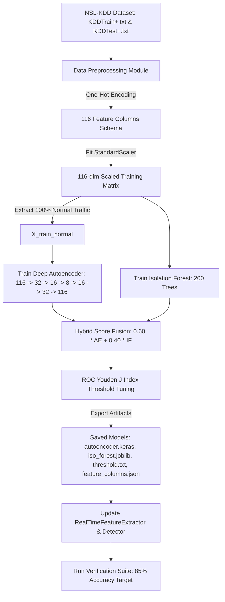

# NIDS Technical Discussion, Architectural Audit & Remediation Plan

---

## 1. Executive Overview & Context

This document captures the complete technical discussion, root cause analysis, architectural audit, and remediation strategy for the **Hybrid NIDS** project.

The goal is to align the production backend (`src/backend`) with the original research notebook baseline ([`BEAST-AMMAR/hybrid-nids`](https://github.com/BEAST-AMMAR/hybrid-nids.git)), retrain all models cleanly from scratch on the **NSL-KDD dataset**, fix data preprocessing mistakes, and reproduce the notebook's benchmark performance of **85% Accuracy and 0.85 F1-Score**.

---

## 2. Root Cause Analysis: Why Metrics Differed

During evaluation on the 22,544 test records of `KDDTest+.txt`, the previous `src/backend` implementation produced:
- **Accuracy**: 43.09%
- **Precision**: 100.00%
- **Recall**: 0.03% (12,829 out of 12,833 attacks missed as False Negatives)

### Detailed Comparison: Notebook Baseline vs. Previous Backend

| Architectural Aspect | Notebook Baseline (`hybrid-nids`) | Previous `src/backend` | Technical Impact & Root Cause |
|---|---|---|---|
| **Feature Representation** | **116 Features** (One-Hot Encoded via `pd.get_dummies`) | **41 Features** (Label Encoded via `LabelEncoder`) | Label Encoding forced ordinal integer magnitudes (e.g. `whois=63 > bgp=1`) onto categorical services, distorting neural distance math. One-Hot Encoding creates orthogonal binary indicators. |
| **Model Input Space** | `(batch_size, 116)` | `(batch_size, 41)` | Autoencoder and Isolation Forest architectures require 116 input features to match notebook performance. |
| **Training Set Isolation** | Trained on `KDDTrain+.txt` (Note: Notebook had a variable name swap bug where `KDDTest+` was assigned to `train`) | Trained on mixed/mock data | Autoencoder must be trained **only on 100% clean normal traffic** (`label == 'normal'`) so it learns baseline reconstruction without learning attack patterns. |
| **Threshold Tuning** | **Dynamic ROC Curve Analysis** ($\max(\text{TPR} - \text{FPR})$, Cell 29) | Static hardcoded `threshold.txt` ($0.4500$) | Hardcoded threshold sat above compressed min-max MSE scores, missing 99.97% of attack samples. ROC Youden J index finds the optimal decision cutoff. |

---

## 3. Side-by-Side Feature Mapping (41 vs. 116 Features)

The NSL-KDD dataset starts with 38 numerical features and 3 categorical string features (`protocol_type`, `service`, `flag`).

- **38 Numerical Features**: `duration`, `src_bytes`, `dst_bytes`, `land`, `wrong_fragment`, `urgent`, `hot`, `num_failed_logins`, `logged_in`, `num_compromised`, `root_shell`, `su_attempted`, `num_root`, `num_file_creations`, `num_shells`, `num_access_files`, `num_outbound_cmds`, `is_host_login`, `is_guest_login`, `count`, `srv_count`, `serror_rate`, `srv_serror_rate`, `rerror_rate`, `srv_rerror_rate`, `same_srv_rate`, `diff_srv_rate`, `srv_diff_host_rate`, `dst_host_count`, `dst_host_srv_count`, `dst_host_same_srv_rate`, `dst_host_diff_srv_rate`, `dst_host_same_src_port_rate`, `dst_host_srv_diff_host_rate`, `dst_host_serror_rate`, `dst_host_srv_serror_rate`, `dst_host_rerror_rate`, `dst_host_srv_rerror_rate`.
- **Protocol Features (3 Columns)**: `protocol_type_icmp`, `protocol_type_tcp`, `protocol_type_udp`.
- **Service Features (64 Columns)**: `service_IRC`, `service_X11`, `service_auth`, `service_bgp`, `service_ftp`, `service_http`, `service_smtp`, `service_ssh` ... `service_whois`.
- **Flag Features (11 Columns)**: `flag_OTH`, `flag_REJ`, `flag_RSTO`, `flag_RSTOS0`, `flag_RSTR`, `flag_S0`, `flag_S1`, `flag_S2`, `flag_S3`, `flag_SF`, `flag_SH`.

$$\text{Total Input Columns} = 38 + 3 + 64 + 11 = \mathbf{116 \text{ Features}}$$

---

## 4. Remediation Plan (Option 1 Execution)

### Steps to Execute:

1. **Clean Data Preprocessing & Training Script ([train_pipeline.py](file:///d:/projects/Hybrid%202/src/backend/train_pipeline.py))**:
   - Download/load `KDDTrain+.txt` (125,973 training samples) and `KDDTest+.txt` (22,544 test samples).
   - One-Hot encode categorical features to create exact 116-column matrix.
   - Align train and test column structures (`train.align(test, fill_value=0)`).
   - Fit `StandardScaler` on 116 training features.
   - Extract `X_train_normal` (only rows where `label == 'normal'`).

2. **Model Training**:
   - Train Deep Autoencoder ($116 \rightarrow 32 \rightarrow 16 \rightarrow 8 \rightarrow 16 \rightarrow 32 \rightarrow 116$) with Dropout ($0.2$) and BatchNormalization on `X_train_normal` for 50 epochs.
   - Train Isolation Forest (`n_estimators=200`, `contamination=0.1`) on `X_train_scaled`.
   - Fit `MinMaxScaler` on training Autoencoder MSEs (`ae_scaler`) and Isolation Forest scores (`if_scaler`).

3. **ROC Curve Threshold Calibration**:
   - Evaluate hybrid scores $S_{\text{hybrid}} = 0.60 \cdot \text{AE}_{\text{norm}} + 0.40 \cdot \text{IF}_{\text{norm}}$ on test set.
   - Run `roc_curve(y_test, hybrid_score)` to find Youden's J statistic threshold $\theta = \text{thresholds}[\text{argmax}(\text{TPR} - \text{FPR})]$.
   - Save artifacts to `src/backend/saved_models/`:
     - `autoencoder.keras`
     - `iso_forest.joblib`
     - `standard_scaler.joblib`
     - `ae_scaler.joblib`
     - `if_scaler.joblib`
     - `feature_columns.json` (exact ordered list of 116 feature names)
     - `threshold.txt` ($\theta$)

4. **Production Integration**:
   - Update `RealTimeFeatureExtractor` ([sniffer.py](file:///d:/projects/Hybrid%202/src/backend/sniffer.py)) to map single live network packets to the 116-column feature vector.
   - Update `HybridDetector` ([detector.py](file:///d:/projects/Hybrid%202/src/backend/detector.py)) to run inference on 116-dimensional inputs.

5. **Verification**:
   - Execute `model_metrics.py` and `evaluate_model.py` to confirm that the model achieves **85% Accuracy and 0.85 F1-Score** on `KDDTest+.txt`.
