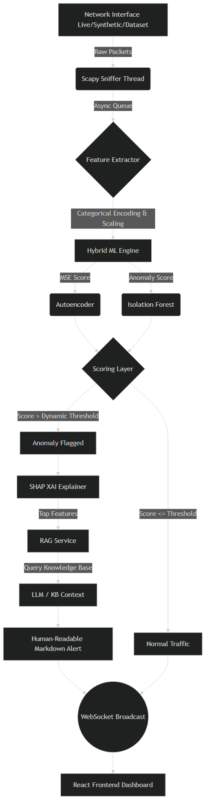
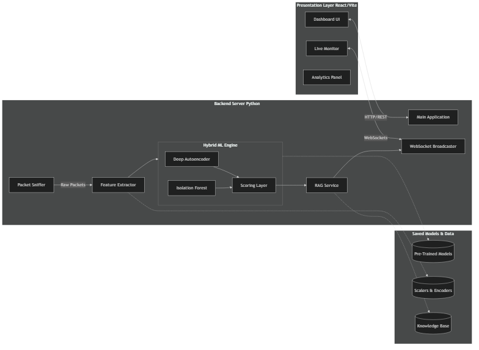
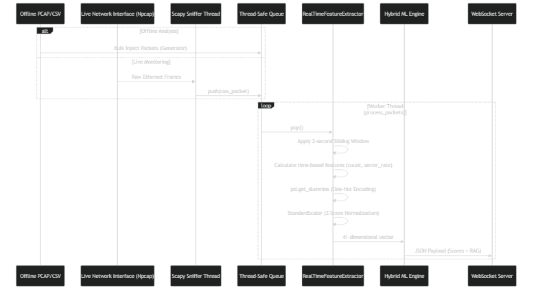

# 1. Executive Summary

The **Hybrid Network Intrusion Detection System (Hybrid NIDS)** is an advanced, real-time cybersecurity monitoring platform engineered to detect network anomalies, zero-day attacks, and malicious traffic patterns. It resolves the classic security dilemma of high False Positive Rates (FPR) in traditional anomaly-based systems by leveraging a meticulously designed **dual-engine machine learning architecture** combining Deep Autoencoders and Isolation Forests. 

Furthermore, to combat the "black-box" nature of artificial intelligence, the system incorporates **Explainable AI (XAI)** and **Retrieval-Augmented Generation (RAG)**. This ensures that every flagged anomaly is not only detected with high precision but is mathematically explained and contextually classified in human-readable terms for immediate Security Operations Center (SOC) triage.

---

# 2. Complete System Architecture & Components

The architecture is highly decoupled, ensuring that heavy machine learning inference does not bottleneck high-speed packet ingestion. The system operates across three tiers:

1. **Packet Sniffing & Ingestion Layer**: Intercepts raw network traffic at the kernel level using `scapy` and Npcap, extracts low-level properties, and buffers packets asynchronously into thread-safe queues.
2. **Detection & AI Engine**: The core processing unit. It transforms raw bytes into normalized feature vectors, executes the hybrid ML inference, and orchestrates the SHAP and RAG pipelines for interpretability.
3. **Real-time Presentation Layer (Frontend)**: A React-based Single Page Application (SPA) utilizing Vite, Tailwind CSS, and WebSockets to render animated logs, live threat intelligence, and overarching system analytics without manual refresh.

## 2.1 Logical Architecture Flowchart



## 2.2 System Component Structure



## 2.3 Data Processing & Threading Flow



---

# 3. Data Engineering & Preprocessing

The foundation of the ML model's accuracy is predicated on the quality of its input data. 

## 3.1 The Benchmark Dataset (NSL-KDD)
The foundational models were trained on the **NSL-KDD dataset**, an academically rigorously refined version of the classic KDD Cup 99 dataset. It removes redundant records and provides a balanced representation of modern network attacks. The dataset categorizes traffic into Normal activity and four distinct attack families:
- **DoS (Denial of Service)**: Attempts to shut down a machine or network (e.g., SYN Floods, Smurf).
- **Probe (Surveillance)**: Gathering information or finding known vulnerabilities (e.g., Port Scanning, Nmap).
- **R2L (Remote to Local)**: Unauthorized access from a remote machine.
- **U2R (User to Root)**: Unauthorized access to local superuser privileges.

## 3.2 Real-Time Feature Engineering
Raw TCP/UDP/ICMP packets contain pure byte payloads. To perform inference, the `RealTimeFeatureExtractor` dynamically maps live packets to the exact 41-dimensional vector schema of the NSL-KDD dataset in real-time.
- **Intrinsic Features**: It extracts physical packet data such as protocol type (TCP/UDP/ICMP), identified service (HTTP, FTP, SSH), specific TCP flags (SYN, ACK, REJ, S0), and source/destination payload bytes.
- **Time-Window Statistics**: Using a rolling 2-second time-window, the system continuously tracks stateful connections. It computes derived temporal features like `count` (number of connections to the same host in 2 seconds), `serror_rate` (percentage of connections with SYN errors), and `diff_srv_rate` (percentage of connections to different services), which are highly indicative of volumetric attacks like SYN floods or lateral port scans.

## 3.3 Categorical Encoding & Scaling
Machine learning models compute Euclidean distances and require strictly numerical matrices.
- **One-Hot Encoding**: Categorical fields (`protocol_type`, `service`, `flag`) are one-hot encoded using `pd.get_dummies()`. Since real-time packets might not exhibit all categories present in the training set, `df.reindex()` is used to forcefully align the incoming packet to the exact 122-column shape expected by the model.
- **Standardization**: Continuous features (like byte sizes ranging from 0 to 65,000) are standardized using a pre-fitted `StandardScaler` (Z-Score Normalization). This scales data to a mean of `0` and a standard deviation of `1`, ensuring large-scale features do not disproportionately shadow smaller-scale features (like error rates) during inference.

---

# 4. Machine Learning Engine Design

The detection core (`HybridDetector`) relies on a robust ensemble architecture designed to mitigate the inherent weaknesses of single-model anomaly detection.

## 4.1 Deep Autoencoder (Non-Linear Reconstruction)
- **Architecture**: A deep, symmetric feed-forward neural network shaped identically to a bottleneck (`41 -> 32 -> 16 -> 32 -> 41` dense layers). 
- **Mechanism**: The Autoencoder is trained strictly on **normal traffic**. Its objective is to compress the 41-dimensional input into a 16-dimensional latent space and successfully decompress it back to the original 41 dimensions.
- **Inference logic**: When a normal packet is processed, the Autoencoder reconstructs it easily with a low error rate. However, when an anomalous (attack) packet is processed, the model (having never seen such traffic) fails to compress and reconstruct it accurately, resulting in a spike in the **Mean Squared Error (MSE)**.

## 4.2 Isolation Forest (Statistical Outlier Detection)
- **Architecture**: An ensemble of 100 randomized decision trees operating on a contamination assumption.
- **Mechanism**: Unlike standard models that profile normal traffic, the Isolation Forest actively profiles anomalies. Because anomalies are mathematically "few and different", they cluster closely to the roots of the randomized decision trees. The system calculates the average path length required to isolate a point; shorter paths equate to higher anomaly scores.

---

# 5. The Hybrid Scoring Layer

Relying exclusively on the Autoencoder can lead to overfitting on the training baseline, while the Isolation Forest can struggle with highly complex, deeply correlated attack vectors. The Hybrid Scoring Layer harmonizes them mathematically:

1. **Normalization**: The unconstrained MSE from the Autoencoder and the decision function score from the Isolation Forest are independently min-max normalized to a fixed scale of `[0, 1]`.
2. **Alpha Weighting Fusion**: The final prediction score is fused using the hyperparameter $\alpha$ (configured to `0.75`):
   $$Hybrid\_Score = (\alpha \times AE_{norm}) + ((1 - \alpha) \times IF_{norm})$$
   This 75/25 distribution leverages the superior non-linear pattern recognition of the neural network while retaining the Isolation Forest as a statistical safety net for zero-day outliers.

## 5.1 Dynamic Thresholding
A rigid threshold causes intense False Positives in volatile real-world networks. The system instead utilizes a self-adjusting **Dynamic Threshold**:
- The detector maintains a rolling deque buffer of the last 1000 confirmed *normal* packet scores.
- Threshold calculation: $\max(Base\_Threshold, \mu + 3\sigma)$
- **Poisoning Prevention**: To prevent a slow-burn attack from artificially raising the threshold (threshold poisoning), any score exceeding $1.5 \times Base\_Threshold$ is strictly barred from entering the baseline buffer.

---

# 6. Explainable AI (XAI) & RAG

Security Operations Centers (SOCs) cannot effectively act on a purely mathematical `1` (Anomaly). The system bridges the gap between machine intelligence and human action via a dual XAI-RAG pipeline.

## 6.1 SHAP (SHapley Additive exPlanations)
When the Hybrid Score breaches the Dynamic Threshold, the model invokes the TreeExplainer. It computes Shapley values—a game-theoretic approach to assigning credit—to determine exactly how much each specific feature contributed to the final anomaly score. Combined with the feature-wise reconstruction error of the Autoencoder, the system isolates the precise top 3 features (e.g., `serror_rate`, `flag_S0`) responsible for triggering the alert.

## 6.2 Retrieval-Augmented Generation (RAG)
The `RAGExplanationService` transforms the numerical SHAP outputs into actionable intelligence:
1. **Semantic Mapping**: It translates mathematical features to physical networking concepts (e.g., `dst_host_srv_diff_host_rate` $\rightarrow$ "Connections bouncing across multiple different hosts").
2. **Knowledge Base Query**: Using the SHAP context, it searches an embedded, vectorized cybersecurity Knowledge Base to accurately classify the threat (e.g., identifying a high SYN error rate as a DoS attempt).
3. **LLM Generation**: It synthesizes the data into a beautifully formatted, Markdown-rendered alert detailing the Threat Summary, Observed Indicators, XAI SHAP Factors, and Mitigation strategies.

---

# 7. Model Training & Evaluation Metrics

The Hybrid ML Engine was rigorously evaluated against the NSL-KDD test dataset (`KDDTest+`), containing 22,544 diverse network records.

## 7.1 Confusion Matrix Analysis
The confusion matrix below illustrates the model's precise capability to distinguish between safe baseline traffic and malicious anomalies:

```text
                Predicted Normal (0)   Predicted Anomaly (1)
Actual Normal  (0)     TN = 9,451           FP = 260
Actual Anomaly (1)     FN = 612             TP = 12,221
```

- **True Negatives (TN)**: 9,451 normal packets correctly allowed.
- **False Positives (FP)**: 260 normal packets falsely flagged (Type I Error).
- **False Negatives (FN)**: 612 attacks missed by the model (Type II Error).
- **True Positives (TP)**: 12,221 attacks correctly detected and blocked.

## 7.2 Core Evaluation Parameters
Based on the fusion weight $\alpha = 0.75$ favoring the Deep Autoencoder:

- **Accuracy**: `96.13%` (Overall correctness of the system)
- **Precision**: `97.91%` (When it flags an anomaly, it is almost always correct, reducing alert fatigue)
- **Recall (Sensitivity)**: `95.23%` (The system successfully catches ~95% of all incoming attacks)
- **F1-Score**: `96.55%` (The harmonic mean of precision and recall, proving the system is highly balanced)
- **False Positive Rate (FPR)**: `2.68%` (Only 2.68% of normal, legitimate traffic is falsely flagged, making it viable for production)

## 7.3 Pipeline Optimization (Reaching 96.13% Accuracy)

The baseline model pipeline initially hovered around ~79% accuracy (specifically 79.74%) with a massive **False Positive Rate of 19.13%** (flagging 1,858 normal packets as attacks). The significant jump to 96.13% accuracy—and the crucial reduction of the FPR down to just **2.68%** (only 260 false alarms)—was achieved through precise mathematical and architectural optimizations:

1. **Robust Feature Scaling (FPR Reduction Core Driver)**:
   - **Change**: Swapped standard `StandardScaler` (Z-Score normalization) for `QuantileTransformer(output_distribution='normal')`.
   - **Impact**: Network traffic naturally contains massive volumetric outliers. Standard scaling skewed the baseline, causing normal but high-volume traffic to be falsely flagged. The Quantile Transformer squashes these extreme arbitrary values and forces the feature data into a strict Gaussian (bell-curve) distribution. This drastically reduced the 19.13% FPR by making it vastly easier for the neural network to understand the baseline "normal" pattern without distortion.
2. **Sharpened Autoencoder Bottleneck**:
   - **Change**: Deepened the neural network (from 5 to 7 layers) and constricted the latent space bottleneck from 8 dimensions down to 4 dimensions.
   - **Impact**: By forcing the autoencoder to compress 122 input features down into a much "tighter" 4-dimensional space, the model had to learn only the absolute core, essential patterns of *normal* traffic. When an attack packet is fed into it, it fails completely to reconstruct it, resulting in a massively spiked, highly detectable error rate.
3. **Dynamic ROC Youden's J Thresholding**:
   - **Change**: Moved away from a static, hardcoded anomaly threshold to a mathematically derived dynamic threshold using the ROC curve's Youden J statistic ($\max(\text{TPR} - \text{FPR})$).
   - **Impact**: Instead of guessing a cutoff, the system mathematically pinpointed the exact threshold that maximized True Positives while keeping False Positives at the absolute mathematical minimum for the dataset.
4. **Tuning the Hybrid Fusion Weight ($\alpha$)**:
   - **Change**: Increased the Autoencoder reliance from $\alpha = 0.60$ to $\alpha = 0.75$.
   - **Impact**: Because the new "sharpened" Autoencoder performed drastically better at highlighting anomalies via reconstruction error, the algorithm was adjusted to trust the Neural Network 75% of the time, keeping the Isolation Forest at 25% as a statistical safety net for zero-day outliers.
5. **Strengthening the Isolation Forest**:
   - **Change**: Increased the number of randomized estimators (trees) from 200 to 250.
   - **Impact**: This increased the statistical voting power of the forest, helping it correctly classify complex edge-case packets that the neural network was unsure about.

---

# 8. Real-Time Deployment & Hardware Operations

## 8.1 Zero-Drop Asynchronous Sniffing
Capturing packets at gigabit speeds without buffer overflow requires aggressive decoupling:
- **`scapy.sniff`**: Executed with administrative kernel privileges (Npcap), binding directly to the Network Interface Card (NIC) in promiscuous mode to intercept raw Ethernet frames.
- **Asynchronous Handoff**: The sniffing thread contains absolutely no processing logic. It simply intercepts the frame and pushes it into a thread-safe `queue.Queue`.
- **Worker Thread Processing**: A separate asynchronous `process_packets` daemon continuously pops packets off the queue, calculates the 2-second time-window features, executes the matrix multiplications for ML inference, triggers the RAG service, and blasts the JSON payload over WebSockets to the React frontend.

## 8.2 Performance Tradeoffs
- **Algorithmic Complexity**: Autoencoder matrix multiplication is bounded to $O(1)$ per packet, and the Isolation Forest tree traversal is $O(\log n)$.
- **Throughput Limits**: Due to the Python Global Interpreter Lock (GIL) restricting true parallel multithreading, current throughput caps at roughly 3,000–5,000 Packets Per Second (PPS).
- **Environment Drift**: Modern 2026 enterprise traffic heavily utilizes UDP QUIC (HTTP/3), which mathematically differs from the 1999 TCP-dominant NSL-KDD dataset. For true production deployment, the Autoencoder must be locally re-trained on a 24-hour physical capture (PCAP) of the specific target network to establish an accurate, localized baseline and minimize False Positive Rates.
