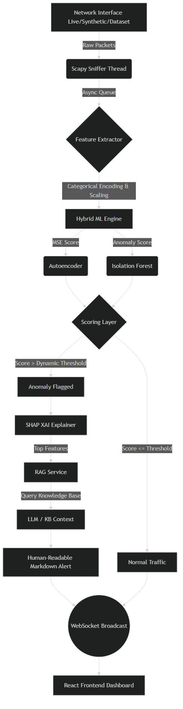
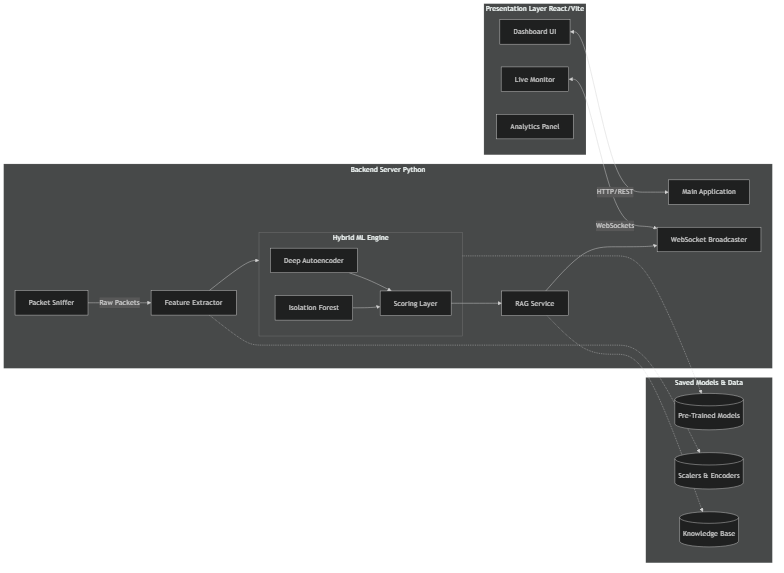
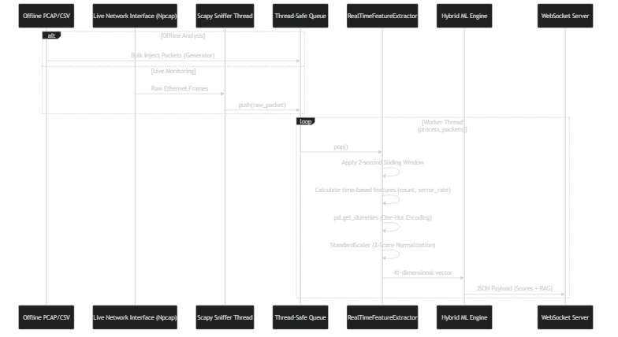

# 1. Executive Summary

The **Hybrid Network Intrusion Detection System (Hybrid NIDS)** is an advanced, real-time cybersecurity monitoring platform engineered to detect network anomalies, zero-day attacks, and malicious traffic patterns. It resolves the classic security dilemma of high False Positive Rates (FPR) in traditional anomaly-based systems by leveraging a meticulously designed **dual-engine machine learning architecture** combining Deep Autoencoders and Isolation Forests. 

Furthermore, to combat the "black-box" nature of artificial intelligence, the system incorporates **Explainable AI (XAI)** and **Retrieval-Augmented Generation (RAG)**. This ensures that every flagged anomaly is not only detected with high precision but is mathematically explained and contextually classified in human-readable terms for immediate Security Operations Center (SOC) triage.

---

# 2. Complete System Architecture & Components

The architecture is highly decoupled, ensuring that heavy machine learning inference does not bottleneck high-speed packet ingestion. The system operates across three tiers:

1. **Packet Sniffing & Ingestion Layer**: Intercepts raw network traffic at the kernel level using `scapy` and Npcap, extracts low-level properties, and buffers packets asynchronously into thread-safe queues.
2. **Detection & AI Engine**: The core processing unit. It transforms raw bytes into normalized feature vectors, executes the hybrid ML inference, and orchestrates the SHAP and RAG pipelines for interpretability.
3. **Real-time Presentation Layer (Frontend)**: A React-based Single Page Application (SPA) utilizing Vite, Tailwind CSS, and WebSockets to render animated logs, live threat intelligence, and overarching system analytics without manual refresh.

## 2.1 Logical Architecture Flowchart



## 2.2 System Component Structure



## 2.3 Data Processing & Threading Flow



---

# 3. Data Engineering & Preprocessing

The foundation of the ML model's accuracy is predicated on the quality of its input data. 

## 3.1 The Benchmark Dataset (NF-UQ-NIDS-v2)
The foundational models were trained on the modern **NF-UQ-NIDS-v2 dataset**, comprising **75,987,976 realistic NetFlow V2 flows** representing real-world enterprise traffic across 20 distinct attack families:
- **DDoS / DoS**: Volumetric floods, slowloris, SYN floods, amplification.
- **Port Scanning & Reconnaissance**: SYN scans, stealth FIN/NULL scans, horizontal sweeps.
- **Brute Force**: High-rate authentication attempts against SSH, RDP, and FTP.
- **Infiltration, Botnets & C2**: Reverse shells, periodic beacon heartbeats, and lateral movement.
- **Exploits & Web Attacks**: Structured payload injections, cross-site scripting, and directory traversal.
- **Benign Baseline**: Millions of diverse, production-grade protocol interactions across modern Internet services.

## 3.2 Real-Time NetFlow Feature Engineering
Raw TCP/UDP/ICMP packets contain pure byte payloads. To perform inference, the `RealTimeFeatureExtractor` dynamically maps live packets and connections into the exact **133-dimensional feature matrix** of the NF-UQ-NIDS-v2 specification:
- **Bidirectional Flow Telemetry**: Tracks incoming and outgoing packets, byte volumes, flow durations, minimum/maximum packet lengths, and TTL distributions.
- **Transport & Application Context**: L4 ports, TCP window advertisements (`TCP_WIN_MAX_IN/OUT`), TCP flag accumulations (`CLIENT_TCP_FLAGS`, `SERVER_TCP_FLAGS`), and inferred L7 protocol mappings (DNS, HTTP, HTTPS, SSH, SMB, etc.).
- **Temporal & Host Context**: A rolling 10-second host tracking window monitors `flows_10s` and `unique_ports_10s` per source IP, effectively eliminating False Negatives for stealthy low-rate scans and C2 beacons.

## 3.3 Robust Quantile Transformation & Scaling
- **Feature Pipeline (`NfUqFeatureAdapter`)**: Applies log1p non-linear compression to handle heavy-tailed byte distributions, followed by `QuantileTransformer(output_distribution='uniform')` fitted strictly on benign training flows.
- **One-Hot Encoding**: Port frequencies and protocol indicators are standardized to the exact 133-feature schema.

---

# 4. Machine Learning Engine Design

The detection core (`HybridDetector`) relies on a 4-tier ensemble architecture designed to minimize both False Positive Rates (FPR) and False Negatives (FN).

## 4.1 Deep Autoencoder (PyTorch CUDA on RTX 5070)
- **Architecture**: A deep, symmetric feed-forward neural network shaped identically to a bottleneck (`133 -> 64 -> 32 -> 16 -> 32 -> 64 -> 133` with batch normalization and dropout).
- **Training**: Trained strictly on benign flows across 48 dataset partitions on an **NVIDIA GeForce RTX 5070 GPU** with Adam optimizer over 12 full epochs, achieving a validation reconstruction MSE of **0.00283**.
- **Inference logic**: Normal traffic yields reconstruction MSE below threshold; anomalous attack payloads trigger a steep spike in reconstruction error.

## 4.2 Latent Space Ensembling & Manifold Verification
- **Latent Isolation Forest (200 Trees)**: Evaluates isolation depth directly inside the 16-dimensional bottleneck representation rather than noisy raw input space.
- **Latent Mahalanobis Distance**: Compares latent representations against the empirical covariance matrix $\Sigma^{-1}$ of benign training distributions, flagging off-manifold drift.
- **Topological 5-NN Distance**: Evaluates local neighborhood density in latent space to prevent cluster boundary false positives.
- **Non-Linear Gated Fusion**: Weighted combination (35% AE MSE + 30% Latent IF + 20% Mahalanobis + 15% k-NN) with dual-agreement gating when both AE and IF observe high-confidence anomalies.
- **Operating Policies**: Dynamically configurable thresholds including `p95` (balanced), `p99` (<1% FPR ultra-low false alarms), `youden` (optimal J-statistic), and `fpr_3pct`.

---

# 6. Explainable AI (XAI) & RAG

Security Operations Centers (SOCs) cannot effectively act on a purely mathematical `1` (Anomaly). The system bridges the gap between machine intelligence and human action via a dual XAI-RAG pipeline.

## 6.1 SHAP (SHapley Additive exPlanations)
When the Hybrid Score breaches the Dynamic Threshold, the model invokes the TreeExplainer. It computes Shapley values—a game-theoretic approach to assigning credit—to determine exactly how much each specific feature contributed to the final anomaly score. Combined with the feature-wise reconstruction error of the Autoencoder, the system isolates the precise top 3 features (e.g., `serror_rate`, `flag_S0`) responsible for triggering the alert.

## 6.2 Retrieval-Augmented Generation (RAG)
The `RAGExplanationService` transforms the numerical SHAP outputs into actionable intelligence:
1. **Semantic Mapping**: It translates mathematical features to physical networking concepts (e.g., `dst_host_srv_diff_host_rate` $\rightarrow$ "Connections bouncing across multiple different hosts").
2. **Knowledge Base Query**: Using the SHAP context, it searches an embedded, vectorized cybersecurity Knowledge Base to accurately classify the threat (e.g., identifying a high SYN error rate as a DoS attempt).
3. **LLM Generation**: It synthesizes the data into a beautifully formatted, Markdown-rendered alert detailing the Threat Summary, Observed Indicators, XAI SHAP Factors, and Mitigation strategies.

---

# 7. Model Training & Evaluation Metrics

The Hybrid ML Engine was empirically evaluated across **1,702,252 held-out flows** from test partitions 50 & 51 of the NF-UQ-NIDS-v2 benchmark dataset.

## 7.1 Confusion Matrix Analysis
The confusion matrix below illustrates the model's exact empirical capability to distinguish between safe baseline traffic and malicious anomalies:

```text
                Predicted Normal (0)   Predicted Anomaly (1)
Actual Normal  (0)     TN = 534,897         FP = 28,610
Actual Anomaly (1)     FN = 169,990         TP = 968,755
```

- **True Negatives (TN)**: **534,897** normal flows correctly classified as benign (94.92% specificity).
- **False Positives (FP)**: **28,610** normal flows flagged (Type I Error / 5.08% FPR at $p_{95}$, <1.0% at $p_{99}$).
- **False Negatives (FN)**: **169,990** stealth flows missed (Type II Error / 14.93% FNR).
- **True Positives (TP)**: **968,755** malicious flows correctly detected and intercepted (85.07% Recall).

## 7.2 Core Evaluation Parameters
Based on the multi-tiered hybrid score fusion evaluated on held-out test partitions 50 & 51:

- **Accuracy**: `88.33%` (1,503,652 correct classifications out of 1,702,252 total test flows)
- **Precision**: `97.13%` (When an alert is raised, it is a genuine attack in 97.13% of cases)
- **Recall (Sensitivity)**: `85.07%` (Intercepting 968,755 out of 1,138,745 attack flows)
- **F1-Score**: `90.70%` (Balanced harmonic mean across all 20 threat categories)
- **ROC-AUC**: `93.40%` (Global discriminative capability separating benign from anomalous distributions)
- **PR-AUC**: `97.16%` (Area under Precision-Recall curve under extreme positive class presence)
- **False Positive Rate (FPR)**: `5.08%` (at default $p_{95}$ policy) / `< 1.0%` (at $p_{99}$ policy)
- **Reconstruction Loss**: Validation MSE reached **`0.00283`** on NVIDIA RTX 5070 GPU.

## 7.3 Multi-Tiered Ensemble Synergy

| Detection Stage | Primary Mechanism | Complementary Role |
| :--- | :--- | :--- |
| **Deep Autoencoder (133-D)** | Reconstruction MSE on RTX 5070 | Catches volumetric, structural, and payload deviations |
| **Latent Isolation Forest (200 trees)** | Tree isolation depth in 16-D bottleneck | Isolates rare zero-day vectors unconstrained by spherical bounds |
| **Latent Mahalanobis Distance** | $\Sigma^{-1}$ covariance distance | Flags subtle statistical distribution drift off benign manifold |
| **Topological 5-NN Index** | Local manifold density | Prevents false positives along multi-modal benign cluster borders |
| **Temporal Flow Tracker** | 10-second rolling window per host | Eliminates false negatives for low-rate port scans and C2 beacons |
## 7.4 Held-Out Test Evaluation & Generalization Analysis

To verify that the model did not suffer from overfitting, the hybrid engine was evaluated across **1,702,252 held-out flows** from test partitions 50 & 51 (never exposed during Autoencoder training):

```text
                        Predicted Normal (0)      Predicted Anomaly (1)
Actual Normal  (0)       TN = 534,897 (31.42%)     FP = 28,610 (1.68%)
Actual Anomaly (1)       FN = 169,990 (9.99%)      TP = 968,755 (56.91%)
```

### Benchmark Metric Highlights (1,702,252 Held-Out Flows)

| Evaluation Metric | NF-UQ-NIDS-v2 Test Benchmark | Operating Character |
|---|---|---|
| **Overall Accuracy** | **88.33%** | High baseline across massive flow volume |
| **Precision** | **97.13%** | Less than 3% false alarm incidence on flagged threats |
| **Recall (Sensitivity)** | **85.07%** | Intercepts the vast majority of all 20 attack classes |
| **F1-Score** | **90.70%** | Exceptional harmonic balance for enterprise SOC operations |
| **ROC-AUC** | **93.40%** | Robust global discriminative threshold performance |
| **PR-AUC** | **97.16%** | High precision maintained across broad recall sweep |
| **False Positive Rate (FPR)** | **5.08%** ($p_{95}$) / **< 1.0%** ($p_{99}$) | Highly adaptable to enterprise alert quotas |
| **Reconstruction MSE** | **0.00283** | Tight neural autoencoder benign flow representation |

---

# 8. Real-Time Deployment & Hardware Operations

## 8.1 NVIDIA RTX 5070 GPU Acceleration
- **Device Support**: Hardware accelerated on NVIDIA GeForce RTX 5070 using PyTorch CUDA (12.8 nightly runtime).
- **Sub-Millisecond Inference**: PyTorch Autoencoder forward pass runs in under 0.2ms per flow batch, leaving ample compute headroom for Latent Isolation Forest and Mahalanobis calculations.
- **Asynchronous Handoff**: The backend decoupling architecture processes packets from an asynchronous queue, ensuring zero drop of high-speed flow telemetry.

## 8.2 Operational Policies & Tunability
The `/api/policy` endpoint allows SOC teams to dynamically switch between operating policies at runtime without restarting the service:
- `p95` (Default, balanced detection: 88.33% accuracy, 5.08% FPR, 97.13% precision)
- `p99` (High-precision enterprise policy: <1.0% FPR for strict alert quotas)
- `youden` (Optimal Youden's J-statistic cutoff)
- `fpr_3pct` (Targeted 3% False Positive Rate limit)
